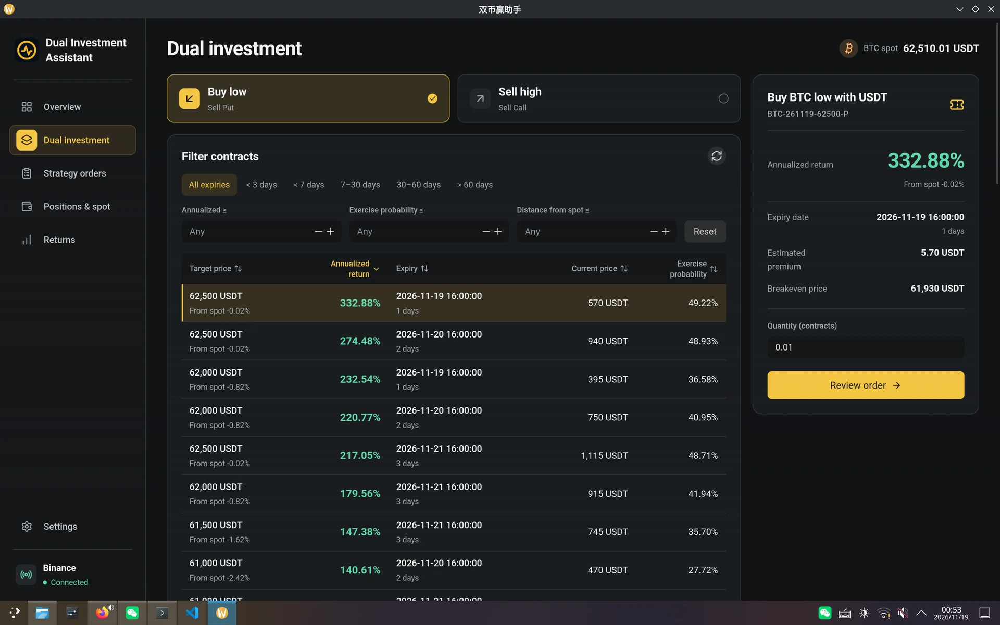
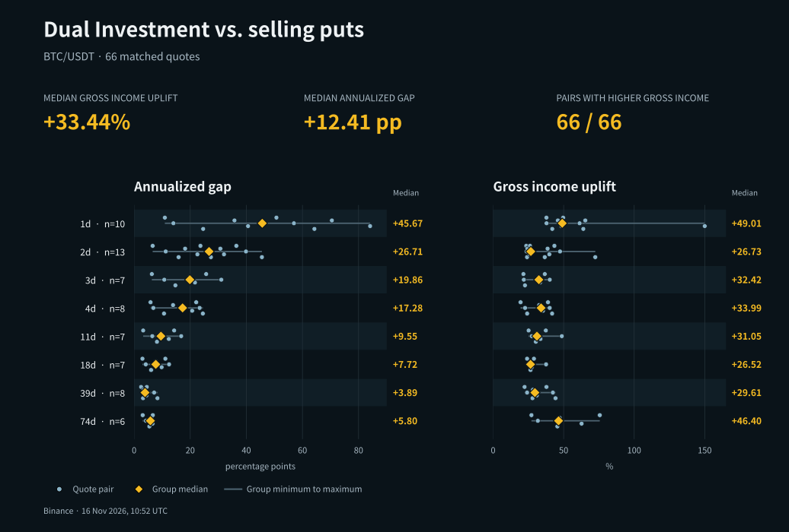
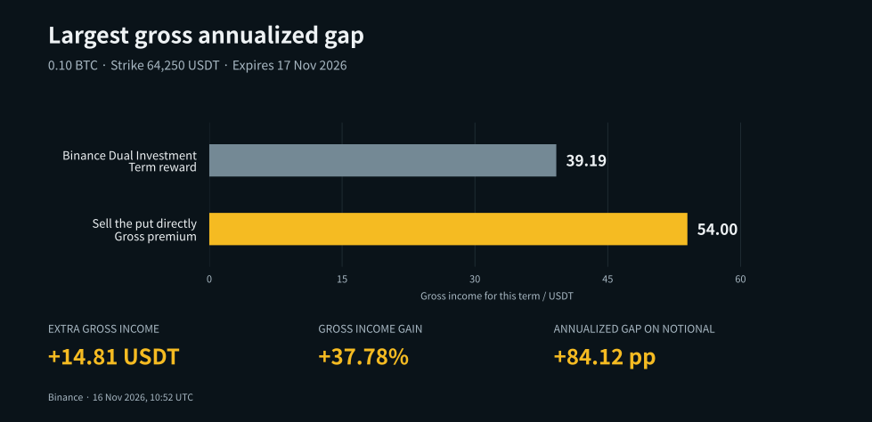

<div align="center">
  
  <h1>Dual Investment Assistant</h1>
  <p><strong>Run BTC/USDT Dual Investment strategies by selling options directly on Binance.</strong></p>
  <p>Choose a contract and confirm your order. The app tracks short positions and trades spot based on exercise results at expiry.</p>
  <p>Binance · BTC/USDT · 13 interface languages · <a href="LICENSE">AGPL-3.0-only</a></p>
  <p><a href="README.md">简体中文</a> · <strong>English</strong></p>
  <p>
    <a href="#dual-investment-vs-selling-puts">Compare returns</a> ·
    <a href="#quick-start">Quick start</a> ·
    <a href="#workflow">Workflow</a> ·
    <a href="#documentation">Documentation</a> ·
    <a href="#development">Contribute</a>
  </p>
</div>



## Dual Investment vs. selling puts

We compared 66 pairs of Binance quotes on **16 November 2026**, each with the same strike and expiry. Selling puts directly offered **33.44% more gross income at the median**, with a **median annualized difference of 12.41 percentage points** before costs.

Comparisons use the same notional principal, **exclude trading costs and capital buffers, and assume no exercise at expiry**. The results reflect quotes at that time. Actual fills and later prices may differ; the figures do not establish a win rate or predict future returns.



See the [group statistics, sources and calculations](docs/yield-comparison.md), or [all 66 pairs individually](docs/yield-comparison.md#逐笔报价). Detailed notes are in Chinese.

<details>
<summary>Largest annualized difference before costs: +84.12 percentage points</summary>



This is `BTC-261117-64250-P`. See the [calculation](docs/yield-comparison.md#最高样本怎样算) for its terms and amounts.

</details>

## Features

| Feature | What it does |
| --- | --- |
| Selection and orders | Sell puts to buy low or calls to sell high. Filter by expiry, annualized estimate, exercise probability and distance from spot, then confirm manually. |
| Positions and delivery | Track short net positions and handle spot delivery for positions tracked before expiry. Check problems in the recovery center. |
| Premium tracking | View locally recorded and today's sell premiums, with Put/Call fill history. |
| Local storage | Keep credentials in the system keyring and records in an account-bound SQLite database. |

> [!IMPORTANT]
> **The app places live trades. Use a dedicated account.** It sends spot orders in the background to complete delivery tasks. Do not complete the same delivery manually elsewhere, as the app may execute it again. Positions first found after expiry will not trigger delivery. Read the [trading safety guide](docs/trading-safety.md).

## Quick start

### Installation and platform support

Download installers from [GitHub Releases](https://github.com/crablet/dual-investment/releases), or build from source if a matching release is unavailable.

| Platform | Installation | Validation status |
| --- | --- | --- |
| Linux x64 | Install `.deb` / `.rpm`. Requires WebKitGTK 4.1 and Secret Service / keyring. | Used on Linux; individual distributions need compatibility checks. |
| Windows 10 / 11 x64 | Run `-setup.exe`; it downloads WebView2 if needed. | Packaging configured; real-device validation pending. |
| macOS 13.3+, Apple Silicon / Intel | Open the Universal `.dmg` and drag the app to Applications. | Packaging configured; real-device validation pending. |

Windows installers are unsigned; macOS uses ad-hoc signing without notarization. See [platform setup](docs/development.md#平台环境) for first-run details.

### Run from source

Install **Node.js 24+, pnpm 12.9.1, Rust 1.95+** and the [platform dependencies](docs/development.md#平台环境), then run:

```bash
git clone https://github.com/crablet/dual-investment.git
cd dual-investment
pnpm install --frozen-lockfile
pnpm tauri:dev
```

`pnpm dev` previews the UI only; trading requires the Tauri desktop client. See [local packaging](docs/development.md#桌面安装包) and [automated releases](docs/development.md#自动构建与发布). CI uses standard runners in public repositories only and skips private repositories.

## Workflow

If you're signing up for Binance, you're welcome to [use our referral link](https://www.bsmkweb.net/register?ref=ZEABG36I) or enter referral code `ZEABG36I` to receive the applicable trading fee discounts.

1. **Connect** — Enter credentials under **Settings → Binance connection**. Disable withdrawals; enable read, spot and options trading, Simple Earn and Universal Transfer permissions.
2. **Select** — Choose a contract and quantity in **Dual investment**.
3. **Confirm** — Review premium, breakeven and quantity before submitting the order.
4. **Follow delivery** — Keep the app running and connected. Check delivery tasks in **Strategy orders** and exceptions in the recovery center.

After Binance cash-settles the option, the app trades spot to replicate physical delivery. It handles short positions only. If a tracked position expires while the app is offline, processing resumes after reconnection. See the [trading safety guide](docs/trading-safety.md).

<details>
<summary>Account and return calculations</summary>

- Local data is bound to one Binance account. You can replace its API Key; deleting credentials does not remove the binding. Startup attempts to connect with saved credentials.
- Account sync only reads state and retains the previous result on failure. Holdings reflect net positions, not accumulated order history.
- After delivery, funds may still be reserved while transfers or Earn subscriptions finish. Do not clear the database to resolve unfinished trades.
- Premium reporting counts fills from locally recorded sell orders. It excludes external orders and other account gains or losses.

| Metric | Calculation |
| --- | --- |
| Recorded premium | Average fill price × filled contracts, rounded to two decimals per order before summing |
| BTC amount | Contracts × BTC per contract (`unit`) |
| Put / Call breakeven | Strike minus / plus premium per BTC |
| Simple annualized estimate (%) | Premium ÷ (strike × BTC amount) × 365 ÷ days to expiry × 100 |

Fees are excluded. Today's premium uses the order creation date in the local time zone. The term starts at the candidate scan or order creation, rounding up to at least one day. View logs under **Settings → Logs**; deleting them does not remove orders or credentials.

</details>

## Interface languages

简体中文 · English · 繁體中文 · Português (Brasil) · Español · Tiếng Việt · Türkçe · Bahasa Indonesia · 日本語 · 한국어 · ไทย · Esperanto · Français

Choose a language in **Settings → General settings**. By default, the app uses your system language, or English if it is not supported. All languages are included in the installer.

## Documentation

The detailed guides are in Chinese.

| Topic | Guide |
| --- | --- |
| Quote sources, statistics and calculations | [Return comparison](docs/yield-comparison.md) |
| Trading checks, reserved funds and recovery rules | [Trading safety](docs/trading-safety.md) |
| Environment, code entry points, localization, checks and releases | [Development](docs/development.md) |

## Development

Vue 3, TypeScript and Pinia; Tauri 2 and Rust; SQLite for local storage. Financial calculations use Rust Decimal.

Report problems through [Issues](https://github.com/crablet/dual-investment/issues) or contribute a PR. Include your system, reproduction steps and sanitized errors; omit credentials, signed requests and raw Binance responses. Read [AGENTS.md](AGENTS.md) and complete the [relevant checks](docs/development.md#验证与打包) before submitting changes.

## License

[AGPL-3.0-only](LICENSE).
