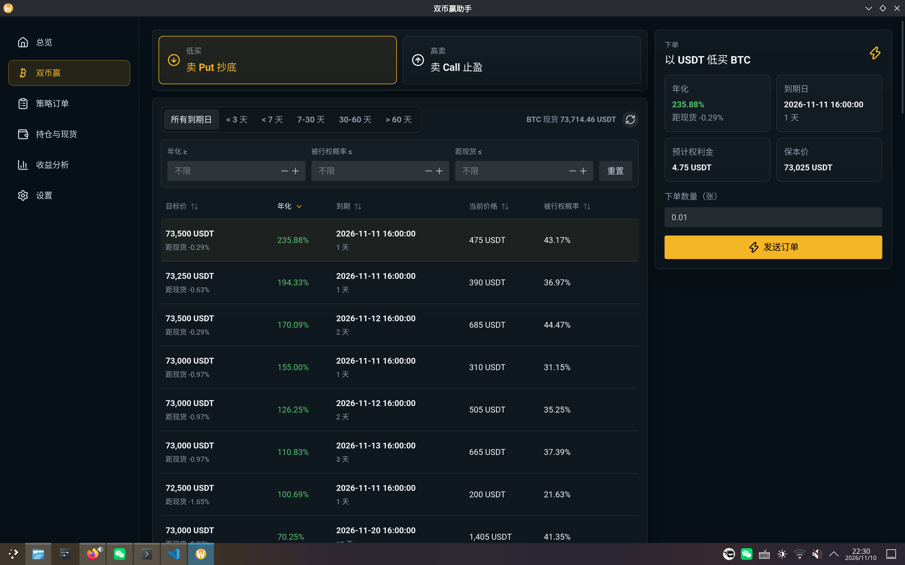

<div align="center">
  
  <h1>双币赢助手</h1>
  <p><strong>直接在 Binance 卖期权，做 BTC/USDT 双币赢策略。</strong></p>
  <p>筛选合约并确认下单后，客户端会跟踪卖方持仓，按到期行权结果交易现货。</p>
  <p>Binance · BTC/USDT · 13 种界面语言 · <a href="LICENSE">AGPL-3.0-only</a></p>
  <p><strong>简体中文</strong> · <a href="README.en.md">English</a></p>
  <p>
    <a href="#双币赢与卖-put-收益对比">收益对比</a> ·
    <a href="#快速开始">快速开始</a> ·
    <a href="#工作流程">工作流程</a> ·
    <a href="#文档">使用文档</a> ·
    <a href="#开发">参与开发</a>
  </p>
</div>



## 双币赢与卖 Put 收益对比

我们在 2026-11-16 对比了 Binance 的 66 组报价，每组的目标价和到期日相同。直接卖 Put 的**毛收益增幅中位数为 33.44%，毛年化差中位数为 12.41 个百分点**。

对比按相同名义本金计算，**未扣交易成本、不计备资缓冲，假设到期未行权**。结果来自当时报价，实际成交和后续行情可能不同，不能据此推算胜率或未来收益。


查看[分组统计、来源与计算口径](docs/yield-comparison.md)，或[66 组逐笔对照](docs/yield-comparison.md#逐笔报价)。

<details>
<summary>毛年化差最大的一组：+84.12 个百分点</summary>


该样本为 `BTC-261117-64250-P`，具体金额与公式见[计算过程](docs/yield-comparison.md#最高样本怎样算)。

</details>

## 功能

通过左侧栏切换页面。设置入口和 Binance 连接状态位于左下角。

| 页面 | 说明 |
| --- | --- |
| 总览 | 查看总资产估值、可用保证金和本机今日卖出权利金。事件日历按日期列出持仓、到期、交割和恢复记录。 |
| 双币赢 | 卖 Put 低买、卖 Call 高卖。按到期日、年化、被行权概率和距现货价格的幅度筛选合约。 |
| 策略订单 | 查看本机订单的实际成交、交割任务和恢复记录。 |
| 持仓与现货 | 查看卖方净仓、资产估值和到期日历。悬停或用 Tab 聚焦余额可查看各账户的明细。 |
| 收益分析 | 查看本机累计和今日卖出权利金、Put / Call 的权利金分布，以及有成交的本机卖单明细。 |
| 设置 | 连接 Binance、更换界面语言、查看本地日志。 |

> [!IMPORTANT]
> **本软件会实盘交易，请使用专用账户。** 后台会按交割任务发送现货订单。不要在其他终端手动补交割，以免重复执行。到期后才首次发现的仓位不会补做交割。使用前阅读[实盘交易安全](docs/trading-safety.md)。

## 快速开始

### 安装与平台状态

从 [GitHub Releases](https://github.com/crablet/dual-investment/releases)下载安装包；没有对应版本时可从源码运行。

| 平台 | 安装方式 | 验证状态 |
| --- | --- | --- |
| Linux x64 | 安装 `.deb` / `.rpm`，需要 WebKitGTK 4.1 与 Secret Service / keyring。 | 已在 Linux 使用，发行版兼容性需分别验证。 |
| Windows 10 / 11 x64 | 运行 `-setup.exe`；缺少 WebView2 时安装器会下载。 | 已配置打包，待实机验证。 |
| macOS 13.3+，Apple Silicon / Intel | 打开通用版 `.dmg`，拖入“应用程序”。 | 已配置打包，待实机验证。 |

Windows 安装包未签名，macOS 使用 ad-hoc 签名、未公证；首次运行说明见[平台环境](docs/development.md#平台环境)。

### 从源码运行

准备 **Node.js 24+、pnpm 12.9.1、Rust 1.95+** 和对应的[平台依赖](docs/development.md#平台环境)，然后执行：

```bash
git clone https://github.com/crablet/dual-investment.git
cd dual-investment
pnpm install --frozen-lockfile
pnpm tauri:dev
```

运行 `pnpm dev` 后，可在浏览器打开 `http://127.0.0.1:1420` 预览界面。账户查询、合约扫描、本地日志和下单均需要 Tauri 桌面客户端。打包见[本地构建](docs/development.md#桌面安装包)或[自动发布](docs/development.md#自动构建与发布)；自动构建只在公开仓库使用标准 runner，私有仓库跳过。

## 工作流程

如果你正好准备注册币安，欢迎[使用我们的邀请链接](https://www.bsmkweb.net/register?ref=ZEABG36I)，或填写邀请码 `ZEABG36I`，你可享受相应的手续费优惠

1. **连接账户** — 在“设置 → Binance 连接”填写凭据。关闭提现权限，配置读取、现货与期权交易、Simple Earn 和 Universal Transfer 权限。
2. **选择合约** — 在“双币赢”选择“低买”或“高卖”。点击候选表的列标题可排序，选中合约后在右侧输入张数。
3. **复核并下单** — 点“复核订单”，核对完整合约代码、到期日、张数、预计权利金和保本价。点“返回修改”可调整订单，点“确认下单”才提交实盘委托。
4. **跟踪交割** — 保持客户端运行并连接，在“策略订单”查看交割任务；异常进入恢复中心核对。

Binance 期权现金结算后，客户端通过现货交易模拟实物交割。只处理卖方持仓；到期前已跟踪的持仓，即使离线期间到期，重连后也会继续处理。规则见[实盘交易安全](docs/trading-safety.md)。

<details>
<summary>账户与收益说明</summary>

- 凭据保存在系统 keyring，订单、净仓和交割记录保存在绑定单个 Binance 账户的 SQLite 数据库。同账户可更换 API Key，删除凭据后仍保留账户绑定。启动时会尝试使用已保存凭据连接。
- “策略订单”里的“同步账户”查询委托、净仓和资产，并在本地为符合条件的到期持仓登记交割任务。净仓或估值查询失败时保留上次成功结果。同一合约按净仓展示，不按历史订单累计。
- 交割任务完成后，同批资金可能还在划转或申购理财，这期间仍会预留资金。不要通过清空数据库处理未完成交易。
- 收益分析只统计本机卖单已成交部分的权利金，不包含外部订单和账户的其他盈亏。

| 指标 | 计算方式 |
| --- | --- |
| 本机权利金 | 成交均价 × 已成交张数，每笔保留两位小数后汇总 |
| BTC 数量 | 合约张数 × 每张 BTC 数量 `unit` |
| Put / Call 保本价 | 执行价减去 / 加上每 BTC 权利金 |
| 单利年化（%） | 权利金 ÷（执行价 × BTC 数量）× 365 ÷ 到期天数 × 100 |

以上不扣手续费。“今日权利金”按订单创建日期和本机时区统计；到期天数从扫描或订单创建时点起算，向上取整、至少 1 天。

</details>

### 查看本地日志

“设置 → 日志”最多显示最近 120 条记录，最新一条在顶部。设置页可见时每 3 秒自动刷新，切到其他页面或隐藏窗口后暂停，返回时立即读取。

普通界面文字默认禁用拖选，输入框仍支持选择和粘贴。要复制日志内容，点“打开今日日志”，或点“打开日志文件夹”查找其他日期的文件。“删除日志”经确认后清理本地日志文件，订单和凭据均保留。

## 界面语言

简体中文 · English · 繁體中文 · Português (Brasil) · Español · Tiếng Việt · Türkçe · Bahasa Indonesia · 日本語 · 한국어 · ไทย · Esperanto · Français

在“设置 → 通用设置”切换。默认跟随系统语言，不支持时使用英语；所有语言均随安装包提供。

## 文档

| 内容 | 文档 |
| --- | --- |
| 报价来源、分组统计与计算方法 | [收益对比](docs/yield-comparison.md) |
| 交易保护、资金预留与恢复约束 | [实盘交易安全](docs/trading-safety.md) |
| 环境、代码入口、多语言、检查与发布 | [开发指南](docs/development.md) |

## 开发

Vue 3 + TypeScript + Pinia，Tauri 2 + Rust，SQLite 本地存储。金融计算由 Rust Decimal 完成。

欢迎通过 [Issues](https://github.com/crablet/dual-investment/issues)反馈问题或提交 PR。反馈时附系统、复现步骤和脱敏错误信息，不附凭据、签名请求或 Binance 原始响应。修改前阅读 [AGENTS.md](AGENTS.md)，按[开发指南](docs/development.md#验证与打包)完成相关检查。

## 许可证

[AGPL-3.0-only](LICENSE)。
