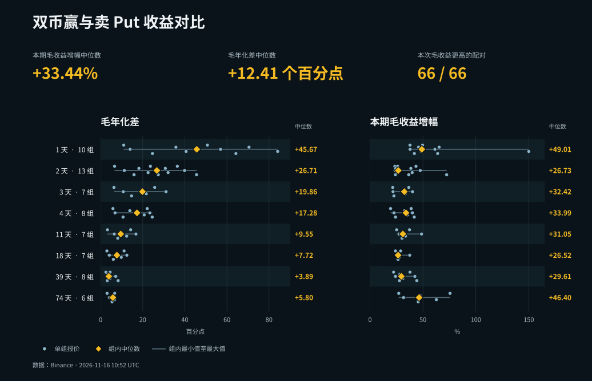
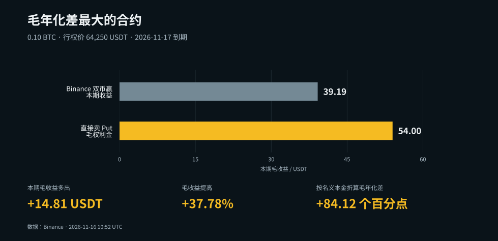

<div align="center">
  
  <h1>双币赢助手</h1>
  <p><strong>在桌面上管理 BTC/USDT 双币赢式策略。</strong></p>
  <p>连接 Binance 期权与现货，筛选合约、确认下单，自动跟踪卖方净仓并处理到期交割。</p>
  <p>Binance · BTC/USDT · 13 种界面语言 · <a href="LICENSE">AGPL-3.0-only</a></p>
  <p><strong>简体中文</strong> · <a href="README.en.md">English</a></p>
  <p>
    <a href="#真实报价算清收益差">收益对比</a> ·
    <a href="#快速开始">快速开始</a> ·
    <a href="#工作流程">工作流程</a> ·
    <a href="#文档">使用文档</a> ·
    <a href="#开发">参与开发</a>
  </p>
</div>


## 真实报价，算清收益差

2026-11-16 的 Binance 报价采样中，66 组同目标价、同到期日的对比显示：直接卖 Put 的**毛收益增幅中位数为 33.44%，毛年化差中位数为 12.41 个百分点**。

对比使用同一名义本金，**未扣交易成本、不计备资缓冲，假设到期未行权**。这是报价差，不是已成交业绩、交易胜率或未来收益承诺。



查看[分组统计、来源与计算口径](docs/yield-comparison.md)，或[66 组逐笔对照](docs/yield-comparison.md#逐笔报价)。

<details>
<summary>最高样本：毛年化差 +84.12 个百分点</summary>



该样本为 `BTC-261117-64250-P`，具体金额与公式见[计算过程](docs/yield-comparison.md#最高样本怎样算)。

</details>

## 从筛选到结算

| 能力 | 内容 |
| --- | --- |
| 筛选与下单 | 卖 Put 低买、卖 Call 高卖；按到期日、年化、行权概率和距现价筛选，复核后手动提交。 |
| 净仓与交割 | 自动同步卖方净仓，对到期前已登记的义务执行现货交割，在恢复中心处理异常。 |
| 权利金统计 | 查看本机已记录和今日卖出权利金，按 Put / Call 分类查看成交。 |
| 本地保存 | 凭据存入系统 keyring，订单、净仓及交割记录保存在按账户绑定的 SQLite 中。 |

> [!IMPORTANT]
> **这是实盘客户端，请专号专用。** 后台可为已登记仓位发送真实现货订单；不要在其他终端手工补交割，以免重复执行。到期后才首次发现的仓位不会追溯补做。使用前阅读[实盘交易安全](docs/trading-safety.md)。

## 快速开始

### 安装与平台状态

从 [GitHub Releases](https://github.com/crablet/dual-investment/releases)下载安装包；没有对应版本时可从源码运行。

| 平台 | 安装方式 | 验证状态 |
| --- | --- | --- |
| Linux x64 | 安装 `.deb` / `.rpm`，需要 WebKitGTK 4.1 与 Secret Service / keyring。 | 已在 Linux 使用，发行版兼容性需分别验证。 |
| Windows 10 / 11 x64 | 运行 `-setup.exe`；缺少 WebView2 时安装器会下载。 | 已配置打包，待实机验证。 |
| macOS 13.3+，Apple Silicon / Intel | 打开通用版 `.dmg`，拖入“应用程序”。 | 已配置打包，待实机验证。 |

Windows 安装包未签名，macOS 使用 ad-hoc 签名、未公证；首次运行说明见[平台环境](docs/development.md#平台环境)。

### 从源码运行

准备 **Node.js 24+、pnpm 12.9.1、Rust 1.95+** 和对应的[平台依赖](docs/development.md#平台环境)，然后执行：

```bash
git clone https://github.com/crablet/dual-investment.git
cd dual-investment
pnpm install --frozen-lockfile
pnpm tauri:dev
```

`pnpm dev` 仅预览界面，交易功能需要 Tauri 桌面客户端。[本地打包](docs/development.md#桌面安装包)和[自动发布](docs/development.md#自动构建与发布)另有说明；自动构建仅在公开仓库使用标准 runner，私有仓库跳过。

## 工作流程

如果你正好准备注册币安，欢迎[使用我们的邀请链接](https://www.bsmkweb.net/register?ref=ZEABG36I)，或填写邀请码 `ZEABG36I`，你可享受相应的手续费优惠

1. **连接账户** — 在“设置 → Binance 连接”填写凭据。关闭提现权限，配置读取、现货与期权交易、Simple Earn 和 Universal Transfer 权限。
2. **选择策略** — 在“双币赢”筛选合约、输入数量。
3. **确认订单** — 在复核窗口检查权利金、保本价与数量后提交。
4. **跟踪交割** — 保持客户端运行并连接，在“策略订单”查看交割任务；异常进入恢复中心核对。

Binance 期权现金结算后，客户端执行现货交易模拟实物交割。只处理卖方持仓，已登记义务可在离线跨期后恢复。处理规则见[实盘交易安全](docs/trading-safety.md)。

<details>
<summary>账户与收益说明</summary>

- 本地数据绑定一个 Binance 账户，同账户可更换 API Key；删除凭据不解除绑定。启动时会尝试使用已保存凭据连接。
- “同步账户”只读取状态，查询失败保留上次结果。同一合约按净仓展示，不按历史订单累计。
- 交割任务完成后，批次可能仍在资金收尾并保留资金；清空数据库不能解决未完成交易。
- 收益分析只统计本机卖单已成交部分的权利金，不补记外部订单，也不是全账户总收益。

| 指标 | 计算方式 |
| --- | --- |
| 本机权利金 | 成交均价 × 已成交张数，每笔保留两位小数后汇总 |
| BTC 数量 | 合约张数 × 每张 BTC 数量 `unit` |
| Put / Call 保本价 | 执行价减去 / 加上每 BTC 权利金 |
| 单利年化（%） | 权利金 ÷（执行价 × BTC 数量）× 365 ÷ 到期天数 × 100 |

以上不扣手续费。“今日权利金”按订单创建日期和本机时区统计；到期天数从扫描或订单创建时点起算，向上取整、至少 1 天。日志在“设置 → 日志”查看，删除日志不影响订单或凭据。

</details>

## 用你熟悉的语言

简体中文 · English · 繁體中文 · Português (Brasil) · Español · Tiếng Việt · Türkçe · Bahasa Indonesia · 日本語 · 한국어 · ไทย · Esperanto · Français

在“设置 → 通用设置”切换；默认跟随系统，未匹配时使用英语，语言资源随应用提供。

## 文档

| 内容 | 文档 |
| --- | --- |
| 报价来源、分组统计与计算方法 | [收益对比](docs/yield-comparison.md) |
| 交易保护、资金预留与恢复约束 | [实盘交易安全](docs/trading-safety.md) |
| 环境、代码入口、多语言、检查与发布 | [开发指南](docs/development.md) |

## 开发

Vue 3 + TypeScript + Pinia，Tauri 2 + Rust，SQLite 本地存储。金融计算由 Rust Decimal 完成。

欢迎通过 [Issues](https://github.com/crablet/dual-investment/issues)反馈问题或提交 PR。反馈时附系统、复现步骤和脱敏错误信息，不附凭据、签名请求或 Binance 原始响应。修改前阅读 [AGENTS.md](AGENTS.md)，按[开发指南](docs/development.md#验证与打包)完成相关检查。

## 许可证

[AGPL-3.0-only](LICENSE)。
